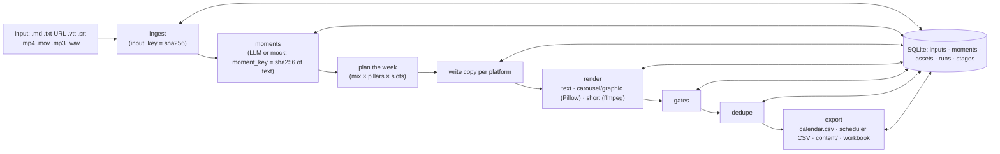

# plan.md — Social Growth Engine (IncuBrix 2027 Growth Engineer, Option 2) · lean version

> **Goal:** a strategy grounded in real product use and real account numbers, **30–36 excellent ready-to-publish
> assets** (scale to 60 only if they pass our own audit), an honest real-audience test, a launch kit IncuBrix can run
> next Monday, and a **lean, reliable engine** that turns one long input into ≥ 10 (target ≥ 20) platform-ready assets
> in under 30 minutes, with brand checks, no duplicates and a scheduler-ready export.
>
> **Approach: "A-lean + C".** Our own small Python engine does everything that must be automatic and repeatable.
> IncuBrix itself makes the *showcase* videos (dogfooding), but the engine never depends on IncuBrix to run.
>
> **Realistic target: strong hire (75–84).** Exceptional is upside, not the plan. It needs all four exceptional items.

Sources: the brief (`IncuBrix_2027_Growth_Engineer_Option_2_Social_Media_and_Content.pdf`, 3 pages, marked
Confidential) and the submission workbook (tabs 00–04). Keep both in `brief/` (gitignored). Fill a **copy** of the workbook.

---

## 0. Points → where the time goes

| Area | Points | Share of effort | What earns it |
|---|---|---|---|
| Content and strategy | **35** | ~40% | Strong hooks, ready to post (15); strategy fits audience and platforms (10); honest, useful real-audience test (10) |
| Live review | **25** | ~15% | Trace 5 random assets to evidence; engine runs on a new input; explain one decision you'd change |
| Automation and scale | **20** | ~25% | Runs from the README on another machine; refresh, no duplicates, error logs, runtime and cost |
| Product and market insight | **10** | ~10% | Specific, evidenced observations and actionable opportunities |
| Launch readiness | **10** | ~10% | Steps, owners, budget, targets: nothing needs rework |

**Gates:**
- Made-up evidence, or being unable to explain and rerun your work, disqualifies the submission.
- Minimums: 30 Ready assets · 3+ platforms · 10+ short videos ≤ 60 s · 5+ carousels or graphics · 85%+ of a random 20-asset audit passes · 0 rights issues · 10+ assets from a new input during the live review · real-audience test done and reported honestly.

**Rules:**
1. **Quality beats count.** The audit samples 20 at random, so the pass rate is what matters. Produce 30–36 first and go to 60 only if `growthengine audit` passes ≥ 95% on 3 seeds.
2. **Every claim has evidence:** screenshot, log, CSV row or video timestamp.
3. **Only claim product features you saw working.** The engine enforces this with `config/claims.yaml`.
4. **One source of truth.** `calendar.csv`, the workbook rows and run summaries are all generated from the engine's database. Never type totals.

---

## 1. Scope: core vs stretch

| Core (must ship) | Stretch (only after core is green) |
|---|---|
| CLI with one run command, `--llm mock` (no API key) | Docker image |
| Text/markdown/URL/transcript/video inputs; faster-whisper optional | `RENDERER=editengine` (reuse the PS2 project) |
| Moment extraction → week plan → per-platform copy | Scheduler-specific bulk formats (Buffer/Hootsuite) |
| Renders: text posts, threads, carousels (PNG + LinkedIn PDF), graphics, 9:16 shorts with burned captions | LLM "useful" judge (a deterministic rubric is core) |
| Gates: voice rules, claims allowlist, platform limits, rights, UTM | 60 assets / 20+ videos |
| Dedupe + idempotent refresh (content-derived IDs) | Preference survey (20 people) in addition to the publish test |
| JSONL logs, stage checkpoints, `--resume`, fault injection | |
| `calendar.csv` (exact workbook columns) + generic scheduler CSV + workbook fill | |
| `audit` (random-20 rehearsal) and `trace` (asset → evidence) | |
| pytest suite + GitHub Actions CI + no-secrets check | |

**Cut order if time runs short** (cut the first first): stretch items → 60-asset scale-up → extra platforms beyond 3.
**Never cut:** test posts, claim checks, CSV/workbook agreement.

---

## 2. Cost: everything free except the model calls

| Piece | Cost | Choice |
|---|---|---|
| Build tools | free | Python 3.10, ffmpeg 9, git, Docker are already on the laptop; Pillow, SQLite, pytest |
| Code and CI | free | private GitHub repo + Actions free tier |
| "Deploy" | free | Nothing to host. The CLI is run from the README; the live review runs on the laptop |
| Publishing | free | Own accounts; native schedulers (LinkedIn, Meta Business Suite, YouTube Studio); IncuBrix publisher ("free to start", limits to check) |
| Storage and videos | free | Google Drive (main output), unlisted YouTube (the two videos) |
| Fonts and music | free | OFL fonts only; no music |
| **LLM** | **paid, small** | Claude API (`claude-opus-5-5`). Estimate ~$1 per 20-asset run, ~$10–20 total; set a spend limit in the console. **Measured** cost is reported from `usage` in every run summary |

Not chosen: a local model via Ollama. It's free, but CPU-only on this laptop (no NVIDIA GPU, 16 GB RAM), so it's slow,
writes weaker copy, and the 30-min target becomes tight. Mock mode keeps the engine runnable for free.

---

## 3. Non-negotiables

1. **Real-audience test starts Day 1–2.** It needs 10+ posts over 5+ days; Day-1 posts can be hand-made (disclosed).
2. **Rights-safe sources only:** your face and voice, your own screen recordings of your own IncuBrix account (clean browser profile, no other users' data), text you wrote, OFL fonts, no music. AI voice, avatar or images → `ai_label_needed = Yes`, and the platform's AI label is applied when posting.
3. **Own accounts, clearly unofficial.** Bio: *"Independent creator-tools content, made for an IncuBrix hiring assessment. Not an official IncuBrix account."* No IncuBrix logo used in an official-looking way. No bought or solicited engagement.
4. **Don't contact creators or brands.** The UGC format is prepared for IncuBrix to run, not run by you.
5. **Competitor numbers by hand** from public pages, with dated screenshots. No scrapers or login bypass.
6. **No secrets in the repo.** `.env.example` only; CI scans for keys.
7. **Short paths on Windows** (e.g. clone to `E:\ige2\` if paths get long). Long temp paths broke `ffmpeg`/`pdftotext` during planning.
8. **Disclose AI help** (including Claude Code building the engine with you) in `AI_USE.md` and `00_START!B16/B18`. You must be able to explain and rerun every part.

---

## 4. Deliverables

| # | Item | Contents |
|---|---|---|
| 1 | Workbook | tabs 00–04 complete, evidence links, `02_ASSETS` = `calendar.csv` |
| 2 | Main output (Drive) | `calendar.csv`, `scheduler_export.csv`, `LICENSES.md`, `assets/<asset_id>/` (final file, caption, editable source, meta, checks) |
| 3 | Engine (private repo) | code, config, tests, CI, README with one run command, samples |
| 4 | Launch kit | one doc: Monday plan, owners, tools, budget, targets, risks, 30-day calendar, UGC format |
| 5 | Two unedited videos | (a) product walkthrough ≤ 5 min; (b) technical demo ≤ 8 min: normal run, refresh on new input, recovery from one failure |

Repo docs: `docs/insight.md`, `docs/audit.csv` + `audit.md`, `docs/strategy.md`, `docs/test_results.md`, `AI_USE.md`, `SOURCES.md`, `LICENSES.md`.

---

## 5. Product and market insight → `01_INSIGHT`

**Use the product (Day 1, 2–3 h, screen-recorded with OBS).** The recording is your evidence, the raw material for
video (a), input I1, and footage for the "C" showcase clips.

Treat every claim on incubrix.com (read 2026-10-25) as unverified until you see it working:
- Content Insights (trending topics, gaps, ideas)
- transcript-based editing
- clip extraction
- word-by-word captions
- voice clone (own voice only)
- avatar
- publishing to YouTube / Instagram / LinkedIn / Spotify / Bluesky
- team workspace
- performance dashboard, caption translation, brand kit (marked "coming soon" or "rolling out")

Record **Seen working / Partial / Unavailable** with date, time and screenshot in `evidence/product/log.md`. Only
"Seen working" items go into `config/claims.yaml`.

Also check:
- time from sign-up to first exported clip;
- onboarding friction;
- free-plan limits;
- whether UTMs on `www.incubrix.com` survive to sign-up on `app.incubrix.com`;
- whether TikTok or X publishing exists;
- whether a scheduled post actually goes out.

**Five observations:** area · what happened · worked / difficult · evidence · why it matters for growth.

**Account audit:**
- IncuBrix: LinkedIn company page, `@incubrix_official`, Facebook. Search YouTube, TikTok, X and Threads, and record "not found as of <date>" where true.
- **5 peers** from OpusClip, Descript, Riverside, Castmagic, Submagic, Vizard, Kapwing and Headliner.
- Per account per platform: followers, posts in 30 days, format mix, median likes + comments on the last 12 posts, median views, ER per post (**one stated formula**: (likes + comments) ÷ followers), top post and why, CTA/link habits. Each with a dated screenshot.
- `audit.md` turns the numbers into findings that cite `audit.csv` rows. It also produces a **hook bank**: the patterns behind the top posts, which feeds the content (§7.4).

**Three opportunities** (keep only what the data supports):
1. Proof-first content made in IncuBrix.
2. A recurring series peers don't own (e.g. "Before/After edit", "repurpose this episode").
3. LinkedIn for expert-led creators.

Columns: evidence · impact · measure · 30-day target.

---

## 6. Strategy → `docs/strategy.md`

**Audience (primary first):**
- **A. Video podcasters** (weekly 30–90 min episodes).
- **B. Expert-led creators** (coaches, consultants, founders who teach).
- Then **C.** YouTubers with 1k–100k subscribers, and **D.** editors and small content teams.

Geography: US, CA, UK, IE, AU, NZ and SG. US English. These are assumptions; validate them against the audit and the test.

**Platforms:**

| Platform | Role | Why |
|---|---|---|
| LinkedIn | core | Segment B; IncuBrix page exists; publishing listed on the site |
| Instagram | core | Reels + carousels are where creators discover tools; account exists |
| YouTube Shorts | core | Segments A and C; product output is Shorts-shaped |
| X, Threads | secondary | Cheap text reuse of the same insights |
| TikTok | month 2 | Strong audience, but not listed as a publish target; revisit after the product check |
| Reddit | listen only | Strict self-promotion rules |

**Pillars:**

| Pillar | Share | Content |
|---|---|---|
| P1 Repurposing playbooks | 30% | "One episode → a week" workflows |
| P2 Show, don't tell | 20% | Verified product features doing real work (the IncuBrix-made clips) |
| P3 Platform craft | 20% | Hooks, captions, specs, retention |
| P4 Edit teardowns | 15% | Before/after of your own footage |
| P5 Creator ops | 15% | Batching, handoffs, approvals |
| P6 UGC | — | "One Episode, One Week" for IncuBrix to run |

**Voice rules** (in `config/brand.yaml`; the engine lints them):
1. Talk to one creator, as "you".
2. The first line is a specific promise or fact, ≤ 12 words.
3. Average sentence ≤ 18 words.
4. Banned hype words: revolutionary, game-changer, unleash, supercharge, 10x, magic, effortless, best-in-class, bare "AI-powered".
5. No unsourced numbers.
6. Product claims only from `claims.yaml`; no testimonials or customer names.
7. One CTA per post.
8. Hashtags: LinkedIn 3 · Instagram 3–5 · YouTube 3 · X/Threads 0–1.
9. Emoji ≤ 2.
10. Spelled exactly **IncuBrix**.

**Frequency (starting hypothesis):** LinkedIn 5 a week · Instagram 5 (3 Reels + 2 carousels) · YouTube Shorts 5 ·
X and Threads 5 each. Slots in US Eastern mornings and midday, written in UTC in the calendar. Week-1 data decides week 2.

**Social → sign-ups:** hook → value → one CTA → UTM link → incubrix.com → "Free to start, no card" sign-up → first clip exported.
- **UTM format:** `utm_source=<platform>&utm_medium=social&utm_campaign=ge2_launch&utm_content=<asset_id>`. Test posts use `utm_campaign=ge2_audience_test`.
- **Link placement:**
  - LinkedIn: in the post or the first comment.
  - Instagram: bio link and Story stickers (caption links aren't clickable).
  - YouTube Shorts: channel link (description links aren't clickable; verify).
  - X: link in the last post of a thread.
- **Measurement:** IncuBrix shares GA4 (or equivalent) sign-ups by `utm_content`.

---

## 7. Assets

### 7.1 Core mix: 36 assets (stretch: 60)

| Platform | Format | Core | Stretch |
|---|---|---:|---:|
| YouTube Shorts | Short video | 6 | 12 |
| Instagram | Short video | 5 | 10 |
| Instagram | Carousel | 3 | 6 |
| Instagram | Graphic | 1 | 2 |
| LinkedIn | Short video | 2 | 4 |
| LinkedIn | Carousel (PDF) | 3 | 6 |
| LinkedIn | Text post | 6 | 8 |
| X | Thread | 5 | 6 |
| Threads | Text post | 5 | 6 |
| **Total** | | **36** | **60** |
| Short videos | | **13** (≥ 10) | 26 (≥ 20) |
| Carousels + graphics | | **7** (≥ 5) | 14 |

Six of the core shorts are **IncuBrix-made** showcase clips (P2), if clip extraction and captions work on your access.
Their editable source is your original footage + transcript + the export settings, with the IncuBrix project link
noted. If the features don't work, those six slots go to the engine's ffmpeg shorts, and the failure becomes an observation.

### 7.2 Long inputs (all yours)

| ID | Input | Length |
|---|---|---|
| I1 | Your recorded IncuBrix walkthrough with voice-over (demo) | 10–15 min |
| I2 | Your blog post, "Turn one podcast episode into a week of posts" | ~1,500 words |
| I3 | Your solo talk to camera, webinar style | 20–30 min |

Every asset stores `source_input` = input ID + timestamp range or paragraph, for tracing in the live review.

### 7.3 Platform specs (`config/platforms.yaml`, checked by the engine)

| Format | Spec |
|---|---|
| Short video | 1080×1920, ≤ 60 s, H.264/AAC; hook text in first 2 s; burned captions; text out of top ~14% and bottom ~20% |
| LinkedIn carousel | PDF of 1080×1350 pages, 6–10 pages |
| Instagram carousel / graphic | 1080×1350 PNG, 6–10 slides |
| LinkedIn post | ≤ 3,000 chars; hook in the first ~140 |
| Instagram caption | ≤ 2,200 chars |
| YouTube title | ≤ 100 chars |
| X | ≤ 280 chars per post, 4–7 posts |
| Threads | ≤ 500 chars |

Verify each limit against the platform's help pages on Day 3 and cite them in `SOURCES.md`.

### 7.4 Creative quality loop (this is where the 35 points come from)

1. **Hook bank** from the audit's top posts and your own winners (patterns, not copied text).
2. **Rubric**, 1–5 each:
   - hook specific in line 1 or second 1–2?
   - teaches, shows or proves one thing?
   - native to the platform?
   - one clear CTA?
   - on voice?
   Ready means ≥ 4 on every item.
3. **Human pass:** 2 minutes per asset, read aloud and watch the first 2 s muted.
4. **Feedback:** test-post results (§9) update the hook bank and the mix before the final batch.

### 7.5 The 6 readiness checks → proof

| Brief check | Automated | Human |
|---|---|---|
| On-brand and accurate | voice lint + claims allowlist + number-source rule | read aloud |
| Platform-native | format, size, duration (ffprobe), char limits, captions | first 2 s muted |
| Useful | rubric fields present (point, proof, takeaway) | rubric ≥ 4 |
| Rights-safe | every file in `config/rights.yaml`; AI media flagged | nothing you don't own |
| Measurable | valid UTM with `utm_content = asset_id`; target metric in notes | — |
| Ready to publish | final file + caption + scheduled slot exist | final look |

Rejects go to `out/rejected/` with reasons, never to the main output.

---

## 8. Engine (`growthengine`)

### 8.1 Pipeline



### 8.2 Commands

```bash
growthengine run --input samples/I2_blog.md              # the one README command
growthengine run --input talk.mp4 --transcript talk.vtt   # video with a ready transcript (or faster-whisper if installed)
growthengine run --input samples/I2_blog_v2.md           # refresh: unchanged moments keep IDs, new ones are added
growthengine run --resume <run_id>                       # continue a failed run
growthengine audit --sample 20 --seed 7                  # rehearse IncuBrix's random audit
growthengine trace <asset_id>                            # asset → input + location → claims → evidence
growthengine export --workbook brief/workbook_copy.xlsx  # fill 02_ASSETS A–U, formulas untouched
growthengine status
```

### 8.3 IDs, dedupe and refresh

- `asset_id = {platform}-{format}-{moment_key[:6]}`, e.g. `LI-CR-7f3a2c`.
  - Platform codes: LI IG YT TT X TH FB RD.
  - Format codes: SV short video · CR carousel · GR graphic · TX text post · TD thread · LV long video.
- `moment_key` is a hash of the moment's normalised text, so edits elsewhere in the input don't renumber anything.
- **Dedupe:**
  - Same `asset_id` or `content_hash` → unchanged (a repeat run makes 0 new assets and 0 LLM calls).
  - Near-duplicate hook or caption (rapidfuzz ≥ 85 against the whole library) → dropped.
  - Video moments overlapping > 50% → one moment.
  - One moment feeds at most 2 platforms, in different formats.
- **Refresh:** a new or edited input adds new moments, updates changed ones in place (version + 1), and keeps already-scheduled slots.

### 8.4 Gates

| Gate | Checks |
|---|---|
| Brand | `brand.yaml` rules |
| Claims | Feature terms in copy must match a `claims.yaml` entry with an evidence path |
| Numbers | Digits need a `[source:…]` tag in the draft, which is stripped before export |
| Platform | `platforms.yaml` limits; ffprobe for video; Pillow for image/PDF size |
| Rights | Every media file used is listed in `rights.yaml` |
| Measurable | UTM parses, has 4 params, `utm_content == asset_id`; target metric set |

### 8.5 LLM

- Anthropic SDK, `claude-opus-5-5` (`LLM_MODEL` in `.env`); effort `medium` for moments and copy.
- JSON structured outputs validated with Pydantic; `stop_reason` checked (`refusal`, `max_tokens`).
- Server-side refusal fallback on (`fallbacks: "default"`).
- Prompt caching: brand rules + claims + input text are a stable prefix.
- Per-call token usage is logged; cost = tokens × `config/prices.yaml`. Prices as of Oct 2026, re-check before submitting: Opus 5.5 $4 / $20 per MTok, cache reads $0.20.
- `--llm mock`: a deterministic writer for tests and keyless runs. The README says its output is lower quality and never used for submitted assets.

### 8.6 Rendering

- **Text post / thread:** `post.txt`, exactly as posted.
- **Carousel / graphic:** `slides.json` (editable source) → Pillow → PNG slides (1080×1350), and a PDF for LinkedIn. Fonts come from `templates/fonts/` (OFL, licence files included), falling back to Pillow's built-in font.
- **Short video:**
  - cut range snapped to transcript cue boundaries, scaled to 9:16;
  - burned captions (ASS), hook overlay for 2 s, `loudnorm`;
  - sources (`cut.json`, `captions.ass`, `render.cmd`) saved for re-editing.

### 8.7 Export

- **`calendar.csv`:** header = `02_ASSETS` A4:U4 exactly. Values are limited to the workbook dropdowns. Hashtags go at the end of the caption (there's no hashtags column), the target metric goes in `notes`, and `scheduled_date` is ISO 8601 UTC.
- **`scheduler_export.csv`:** `platform, publish_at_utc, text, media_path, link, first_comment`.
- **`--workbook`:** writes columns A–U of `02_ASSETS` from row 5, on a copy, and leaves every formula alone.

### 8.8 Reliability

- `logs/run-<run_id>.jsonl` and `out/<run_id>/run_summary.json`: produced, rejected, duplicates removed, unchanged, runtime, tokens and cost.
- Stage checkpoints in SQLite; `--resume` skips finished work.
- **Fault injection** for demo video (b): `GE_FAULT=llm_timeout@write:3` makes the 3rd copy call fail once.
- Bad input exits with code 2 and a clear message. A failed render rejects that asset, and the run continues.

### 8.9 Tests (`pytest -q`, no key)

- **Unit:** UTM, voice lint, claims, platform checks, IDs, near-dup, CSV header vs workbook.
- **End-to-end (mock):** blog → ≥ 10 assets with rendered carousels.
- **Idempotency:** a second run makes 0 new.
- **Refresh:** v2 adds only the new section.
- **Fault then resume:** ends in the same library as a clean run.
- **Video:** a synthetic clip + VTT → 9:16 short that passes ffprobe; skipped if ffmpeg is missing.
- **No secrets:** no key patterns in tracked files, and `.env` is ignored.

### 8.10 Runs for `03_ENGINE_LAUNCH` B (rows 18–21), filled from `run_summary.json`

| Run | Input | Expect |
|---|---|---|
| Normal | I3 or I2 | ≥ 20 produced |
| Repeat | same input | 0 new, $0 |
| Refresh | I2 → I2 v2 | only new-section assets |
| Failure and recovery | with `GE_FAULT` | resume completes, totals match a clean run |

---

## 9. Real-audience test

**Primary: publish 12–14 posts over 6 days** on your own accounts:
- **Personal LinkedIn first:** a real network gives real reach. Note the audience mismatch honestly.
- New Instagram and YouTube channel; optionally X and Threads.
- Pairs of posts that differ only in hook style. With this few posts the result is directional, not significant; say so.
- **Per post, at 24 h and 72 h, with screenshots:** impressions/views, likes, comments, shares/saves, follows, clicks.
- **Engagement rate** = (likes + comments + shares + saves) ÷ impressions.
- **Clicks** come through a click-counting short link you own. Mark "not measurable" where the platform hides links.

**Benchmark (exceptional #2):** choose one sourced 2026 benchmark with the same denominator, e.g. the Socialinsider
2026 benchmarks. Record the figure, URL and access date in `SOURCES.md`. Small new accounts inflate per-follower ER,
so lead with per-impression ER.

**Optional add-on: a 20-person preference survey.** Run it only if you can recruit target-audience people
legitimately: posted on your own accounts or in communities whose rules allow it, never cold DMs. Show hook A vs B, or
carousel vs thread, and ask which they'd stop for.

**Report** in `docs/test_results.md` and `02_ASSETS` P–S: every post, including the flops, plus what you'd change.

---

## 10. Launch kit (one doc)

1. Goal and 30-day targets.
2. **What IncuBrix provides before Monday:**
   - account access;
   - analytics with UTM sign-up reporting;
   - brand assets;
   - one long-form input a week;
   - an approver (same-day SLA);
   - the optional budget.
3. **Owners:**
   - Growth engineer: engine, analytics, report.
   - Social lead: review, schedule, comments.
   - Founder/expert: one long-form a week, plus personal LinkedIn.
   - Approver.
4. **Weekly loop:**
   - Mon: input → `growthengine run` → 45-min review → schedule.
   - Fri: KPI review → adjust.
5. **Daily (≤ 45 min):** check posts went out, reply to comments within 4 h, 10 thoughtful comments in the niche, log metrics.
6. **30-day calendar** (week × platform × pillar), linked to `calendar.csv`.
7. **Tools and monthly cost:** IncuBrix publisher; Claude API ≈ measured $/run × 4; GA4 (free); shortener (optional).
8. **Targets with formulas:**
   - Reach = posts × IncuBrix's baseline median impressions × stated uplift.
   - ER ≥ the benchmark.
   - Clicks = reach × an assumed CTR, labelled until week-1 data replaces it.
   - Sign-ups = clicks × landing conversion (IncuBrix supplies it).
9. **Optional boost:** $300–500 over 30 days. Each week, boost the top 2 posts by ER after 48 h, target countries only, with daily caps and kill rules.
10. **Risks** (§13).
11. **UGC format "One Episode, One Week":** creator brief, outreach template for IncuBrix to send, consent and rights release (voice/face/AI labelling, revocation), selection criteria, disclosure rules, privacy notes (GDPR/DPDP), tracking, steps.

---

## 11. Workbook fill and quirks

| Tab | Cells | Source |
|---|---|---|
| 00_START | B5–B18, F5–F10 (Yes/No), B21 | details, `AI_USE.md`, links |
| 01_INSIGHT | rows 6–10, 14–16 | `docs/insight.md` |
| 02_ASSETS | rows 5+, A–U | `growthengine export --workbook` |
| 03_ENGINE_LAUNCH | B/C 6–14; rows 18–21; rows 24–31 | CI, `run_summary.json`, launch kit |
| 04_SELF_CHECK | C/E 6–12; B/C/E 17–20; C/E 24–28 | computed counts, honest scores |

Quirks:
- `04_SELF_CHECK!D7` (platforms) has no formula: fill C7 and explain in E7. D11 and D12 are "-" too.
- The status dropdown is only Ready/Draft, though column W also tests "Rejected": keep rejects out of the sheet.
- `00_START!B27` = YES needs all 7 minimums MET + B21 = Yes + all F5:F10 = Yes.
- D6/D8/D9/D10 count `02_ASSETS`, so the C values must match them. Explain any difference in E.

---

## 12. Seven-day schedule

| Day | Content and growth (~60%) | Engine (~40%) | Test posts (running total) |
|---|---|---|---|
| 1 | Product deep-dive (recorded), claims log, accounts with disclosure, start audit, voice rules | Engine skeleton: ingest, mock moments, plan, text copy, `calendar.csv` ✅ | 2 |
| 2 | Finish audit + hook bank + opportunities + strategy; write I2 | Claude adapter, carousel renderer, gates, dedupe, refresh ✅ | 4 |
| 3 | Record I3; make IncuBrix showcase clips; verify platform specs | Video renderer (ffmpeg), transcript input, faster-whisper option | 6 |
| 4 | Engine runs on I1–I3 → ~45 candidates; rubric + human pass → 36 Ready | Fix prompts and templates from review findings | 8 |
| 5 | Update hook bank from test results; final asset batch; (stretch: scale to 60) | Resume/faults, CI, README, **fresh-machine test**, the 4 measured runs | 10 |
| 6 | Launch kit + UGC format; workbook fill; `audit` ×3 seeds | Polish `trace`/`audit`; stretch items if green | 12 |
| 7 | 24 h/72 h metrics, results vs benchmark, record both videos, final checklist, submit | — | (12–14) |

✅ = built in this repo already (see §15).

---

## 13. Risks

| Risk | Mitigation |
|---|---|
| New accounts get no reach | Lead with personal LinkedIn; report honestly; per-impression ER; never buy engagement |
| A product feature doesn't work on your access | Log it with evidence; drop it from claims; fall back to engine-made clips |
| LLM invents a claim or number | Claims allowlist + number rule + human pass; reject rather than patch by hand |
| Rights slip in recordings | Recording checklist (quiet room, clean browser profile, notifications off); `rights.yaml` gate |
| Odd live-review input | md / txt / html URL / vtt / srt / video / audio supported; anything else gets a clear error and a suggested conversion |
| Transcription too slow | `--transcript`, smaller whisper model, cache |
| Workbook drifts from files | Everything generated from the DB; schema test; final `audit` |
| API down during the live review | Say so; show `--llm mock`, labelled as mock |
| Secrets leak | `.env` ignored, CI key scan, revocable key |

---

## 14. Live review prep

1. `growthengine trace <id>` on 10 random assets: input + location → claims → evidence → rights → checks.
2. Rehearse three unseen inputs (an article URL, a 5-min audio, a 3-min video). Time each run, and keep `--count 12` as the default.
3. Prepare two honest "I'd change this" decisions. Examples: text-derived IDs treat a reworded idea as new; skipping or adding the preference survey.

## 15. Build status

| Area | Status |
|---|---|
| Plan | ✅ this file |
| Engine core: ingest (md/txt/html/URL/pdf/vtt/srt/audio/video), moments, plan, copy, gates, dedupe, refresh, export, JSONL logs, resume, fault injection, `audit`, `trace`, `reject`, `record`, `rerender`, workbook fill | ✅ built and tested (mock writer) |
| Claude writer (structured outputs, cached prefix, refusal fallback, cost) | ✅ built, tested against a stub; **needs your API key for a live run** |
| Carousel/graphic renderer (Pillow, CC0 Aileron; OFL fonts optional) | ✅ |
| Video renderer (ffmpeg: 9:16 blur-pad, burned captions, hook overlay, loudnorm) | ✅ tested on a generated clip |
| Tests | ✅ 34 passing (`pytest -q`); CI workflow written (runs once the repo is on GitHub) |
| Fresh-environment check | ✅ clean copy + new venv + README command → 20 Ready assets (same laptop; a second machine is still to do) |
| faster-whisper adapter | written, optional extra, not installed or tested yet |
| Docker, editengine renderer, scheduler-specific formats | stretch |
| Day-1 inputs: claims.yaml, own I1/I2/I3, OFL fonts | ⏳ yours (see §5, §7.2) |

## 16. Final check (from the brief)

- [ ] 5 observations · 3 opportunities · audit with real numbers
- [ ] Strategy (audience, 3+ platforms + why, 4–6 pillars, voice, frequency, sign-up path)
- [ ] 30+ Ready (target 36), ≥ 10 videos, ≥ 5 carousels/graphics, each with hook, caption, hashtags, CTA, UTM, final file, editable source
- [ ] Engine: one command, fresh-machine verified, dedupe, refresh, logs, recovery, tests, no secrets, runtime + cost
- [ ] Real-audience test reported honestly vs a sourced benchmark
- [ ] Launch kit · completed workbook (`00_START!B27` = YES) · `calendar.csv` = `02_ASSETS`
- [ ] README · repo access for IncuBrix · both video links work signed-out
- [ ] `AI_USE.md`: AI tools, where AI helped, manual work, money spent
